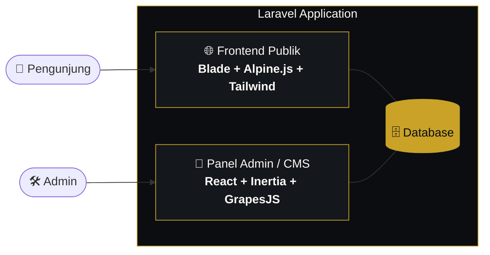

<div align="center">

<br/>


# L U M I N A

### *Digital Agency — crafted with light & precision.*

<br/>


<br/>

**[Tentang](#-tentang) · [Arsitektur](#-arsitektur-hibrida) · [Design System](#-design-system) · [Struktur](#-struktur-halaman) · [Instalasi](#-instalasi) · [Roadmap](#-roadmap)**

<br/>

</div>

---

## ✦ Tentang

**LUMINA Digital Agency** adalah website agensi digital berbasis **Laravel** dengan dua sisi yang bekerja berdampingan:

| | Sisi Publik | Sisi Admin |
|---|---|---|
| **Peran** | Website profil agensi untuk pengunjung | Panel CMS untuk mengelola konten & halaman |
| **Teknologi** | Laravel Blade + Alpine.js + Tailwind CSS | React + Inertia + GrapesJS |
| **Gaya** | Editorial, elegan, dark mode sebagai default | Fungsional, berbasis editor visual |

Frontend publik awalnya dibangun dengan React/TypeScript + Framer Motion, lalu dimigrasikan ke **Blade + Alpine.js** dengan paritas fungsional penuh: lebih ringan, lebih dekat ke server, dan lebih mudah dirawat.

---

## ✦ Arsitektur Hibrida



**Pergantian dari React ke Alpine.js (paritas fungsional):**

| Sebelumnya (React) | Sekarang (Blade + Alpine) |
|---|---|
| `useState` / state komponen | `x-data` |
| Framer Motion `whileInView` | `IntersectionObserver` |
| Framer Motion entrance animation | CSS `@keyframes` |
| Komponen TSX | Partial Blade |

---

## ✦ Design System

Satu bahasa visual untuk seluruh halaman — gelap, hangat, dan berkelas.

<div align="center">

| Ink | Paper | Brass |
|:---:|:---:|:---:|
|  |  |  |
| `#0B0D10` | `#FAF8F4` | `#C9A227` |
| Latar dark mode | Latar light mode | Aksen utama |

</div>

| Elemen | Pilihan |
|---|---|
| **Heading** | Fraunces *(serif)* |
| **Body** | Inter |
| **Mode default** | 🌙 Dark |
| **Dark mode** | Getter Alpine defensif yang seragam di semua komponen (bukan varian `dark:` Tailwind) |

---

## ✦ Struktur Halaman

Seluruh section publik berupa file Blade statis dengan nilai yang diambil langsung dari database, tanpa ketergantungan pada variabel `$content`.

```
resources/views/
├── sections/
│   ├── navbar          →  navigasi utama
│   ├── hero            →  sambutan & CTA
│   ├── tentang-kami    →  profil agensi
│   ├── layanan         →  layanan yang ditawarkan
│   ├── portfolio       →  karya pilihan
│   ├── blog            →  artikel & insight
│   ├── kontak          →  form & informasi kontak
│   └── footer          →  penutup & tautan
```

> Keputusan desain: section dibuat statis agar eksperimen UI tidak bergantung pada panel admin dan database.

---

## ✦ Tech Stack

<div align="center">

| Layer | Teknologi |
|:---:|:---|
| **Backend** | Laravel · PHP · MySQL |
| **Templating** | Blade |
| **Interaktivitas** | Alpine.js |
| **Styling** | Tailwind CSS |
| **Admin / CMS** | React · Inertia · GrapesJS |
| **Tipografi** | Fraunces · Inter |

</div>

---

## ✦ Instalasi

**Prasyarat:** PHP, Composer, Node.js & npm, serta database MySQL.

```bash
# 1. Clone repository
git clone <URL-REPOSITORY-ANDA> lumina
cd lumina

# 2. Install dependensi
composer install
npm install

# 3. Konfigurasi environment
cp .env.example .env
php artisan key:generate

# 4. Atur koneksi database di .env, lalu migrasi
php artisan migrate

# 5. Jalankan (dua terminal)
php artisan serve
npm run dev
```

Buka **http://localhost:8000** 🚀

---

## ✦ Roadmap

- [x] Migrasi frontend publik dari React/TypeScript ke Blade + Alpine.js
- [x] Penyeragaman design system (ink · paper · brass, Fraunces + Inter)
- [x] Konversi seluruh section ke Blade statis
- [ ] Hubungkan kembali section ke database (mulai dari `hero-section`)
- [ ] Lengkapi `section_contents` untuk section selain Hero
- [ ] Tambah tabel `settings` untuk konfigurasi global
- [ ] Hapus tabel bawaan Laravel yang tidak terpakai

---

## ✦ Lisensi

Dibangun di atas [Laravel](https://laravel.com) yang berlisensi [MIT](https://opensource.org/licenses/MIT).
Lisensi proyek LUMINA: *tentukan sendiri (mis. MIT / proprietary).*

<br/>

<div align="center">

**LUMINA Digital Agency**

<sub>Dibuat dengan ☕ dan Laravel</sub>

</div>
