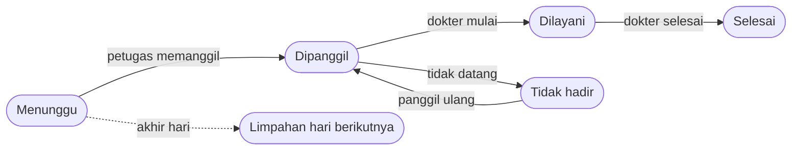

<div align="center">

# Klinik Antrian

**Sistem antrian poliklinik berbasis web dengan perkiraan waktu tunggu dari teori antrian (Queue Theory, model M/M/c).**


</div>

Proyek skripsi: **Pengembangan Sistem Antrian Klinik Berbasis Web Menggunakan Konsep Queue Theory untuk Optimalisasi Pelayanan Pasien.**

Pasien mengambil nomor dari ponsel atau kios tanpa akun, melihat perkiraan waktu tunggu, dan dikabari lewat layar ruang tunggu serta WhatsApp saat giliran tiba. Petugas, dokter, dan admin memakai dashboard sesuai perannya. Halaman analitik membandingkan waktu tunggu hasil rumus dengan data riil.

---

## Fitur

**Untuk pasien (tanpa login)**
- Ambil nomor antrian dengan NIK. Pasien lama dikenali otomatis, pasien baru dibuatkan nomor RM.
- Tiket dengan alamat berkode acak (bukan ID berurutan), memuat nomor, perkiraan tunggu, dan jumlah orang di depan. Halaman menyegarkan diri tiap 15 detik.
- Layar TV per poli dan papan semua poli (Livewire, diperbarui tiap 2 detik).
- Notifikasi WhatsApp saat nomor dipanggil atau dipanggil ulang.

**Untuk petugas**
- Panggil pasien berikutnya (FIFO), panggil ulang, tandai tidak hadir.
- Antrian limpahan dari hari sebelumnya otomatis berada paling depan.
- Ringkasan antrian semua poli dan halaman analitik.

**Untuk dokter**
- Melihat pasien yang dipanggil untuknya, mulai layani, dan selesaikan pelayanan.
- Dokter hanya bisa mengubah pasien miliknya sendiri.

**Untuk admin**
- Kelola poli, dokter, jadwal praktik, dan akun login dokter.

**Otomatis**
- Pembatasan jam pendaftaran dan jam layanan (opsional).
- Penutupan hari: antrian yang belum terpanggil dipindah ke hari berikutnya dengan nomor baru.
- Snapshot metrik harian per poli (λ, μ, ρ, Wq teori dan aktual).

---

## Peran dan akses

| Peran | Akses |
|---|---|
| Pasien | Beranda, ambil nomor, tiket, layar antrian (terbuka) |
| Petugas | Antrian hari ini, kelola poli, analitik |
| Dokter | Pasien saya, mulai dan selesaikan pelayanan |
| Admin | Semua fitur petugas, ditambah data master (poli, dokter, jadwal, akun) |

Pendaftaran akun publik sengaja dimatikan. Akun staf dibuat oleh admin.

---

## Teori antrian yang dipakai

Model **M/M/c**: kedatangan Poisson, lama layanan eksponensial, c dokter melayani paralel. M/M/1 adalah kasus khusus saat c = 1.

| Simbol | Arti | Cara menghitung dari data |
|---|---|---|
| λ | pasien datang per jam | jumlah antrian selesai ÷ (jumlah hari × jam operasional per hari) |
| μ | pasien dilayani per jam per dokter | 3600 ÷ rata-rata lama layanan (detik) |
| c | jumlah dokter | dokter berbeda yang melayani pada rentang data |
| ρ | utilisasi | λ ÷ (c · μ) |
| Wq | rata-rata waktu tunggu | Erlang C: P(menunggu) ÷ (c·μ − λ) |

Sistem stabil bila ρ < 1. Bila ρ ≥ 1, estimasi tidak ditampilkan karena menyesatkan.

**Dua penggunaan yang berbeda:**
1. **Estimasi di tiket pasien** memakai pendekatan sederhana: `(posisi ÷ c) × (1 ÷ μ)`. Parameter λ, μ, c diambil dari 14 hari terakhir dan disimpan di cache 10 menit. Bila data belum cukup, dipakai perkiraan 10 menit per pasien.
2. **Halaman analitik** membandingkan Wq hasil Erlang C dengan Wq aktual (selisih waktu daftar sampai mulai dilayani), lengkap dengan persentase selisih.

Antrian limpahan dikeluarkan dari analitik karena waktu daftarnya dibuat tengah malam dan akan merusak λ dan Wq.

---

## Teknologi

| Lapisan | Teknologi |
|---|---|
| Backend | Laravel 13, PHP 8.3+ |
| Real-time | Livewire 4 (polling) |
| Tampilan | Blade, Bootstrap 5.3, SCSS, Bootstrap Icons, Vite |
| Font | Onest dan Bricolage Grotesque (dibundel npm, tetap tampil tanpa internet) |
| Database | SQLite (default), MySQL untuk produksi |
| Notifikasi | WhatsApp lewat [Fonnte](https://fonnte.com), atau driver log |
| Pengujian | Pest 4 |

---

## Instalasi

**Prasyarat:** PHP 8.3+, Composer, Node.js 20.19+ atau 22.12+, dan npm.

```bash
git clone https://github.com/RzQy08/klinik-antrian.git
cd klinik-antrian

# memasang dependensi, membuat .env, kunci aplikasi, migrasi, dan build aset
touch database/database.sqlite
composer setup

# data contoh: poli, dokter, jadwal, 200 pasien, dan riwayat antrian 30 hari
php artisan db:seed
```

Jalankan mode pengembangan (server, queue, log, dan Vite sekaligus):

```bash
composer dev
```

Buka **http://localhost:8000**.

### Akun demo

Jalankan seeder berikut untuk membuat akun admin, petugas, dan dokter beserta pasien contoh. Daftar email dan password akan dicetak di terminal.

```bash
php artisan db:seed --class=DemoSeeder
```

> Seeder ini **menghapus semua akun, pasien, dan antrian**, lalu membuat ulang. Ia menolak berjalan di produksi.

Saat `APP_ENV=local`, beranda menampilkan tombol **Masuk cepat** untuk tiap peran. Tombol dan rutenya otomatis tidak aktif (404) di produksi.

### Memakai MySQL

Ubah di `.env`:

```env
DB_CONNECTION=mysql
DB_HOST=127.0.0.1
DB_PORT=3306
DB_DATABASE=klinik_antrian
DB_USERNAME=root
DB_PASSWORD=
```

Halaman jadwal praktik admin memakai fungsi `FIELD()` yang hanya ada di MySQL, jadi pakai MySQL bila halaman itu diperlukan.

---

## Konfigurasi

Semua lewat `.env`. Setelah mengubahnya jalankan `php artisan config:clear`.

| Variabel | Fungsi | Bawaan |
|---|---|---|
| `RS_NAMA`, `RS_NAMA_LENGKAP` | nama di navbar, tiket, layar TV, login | RS Bersama |
| `OPERASIONAL_AKTIF` | aktifkan pembatasan jam | `false` |
| `PENDAFTARAN_BUKA`, `PENDAFTARAN_TUTUP` | jam pendaftaran (HH:MM) | `07:00`, `11:00` |
| `LAYANAN_SELESAI` | batas jam memanggil dan memanggil ulang | `14:00` |
| `WA_DRIVER` | `log` (hanya catat) atau `fonnte` (kirim sungguhan) | `log` |
| `WA_FONNTE_TOKEN` | token perangkat dari dashboard Fonnte | kosong |
| `WA_REDIRECT_KE` | semua pesan dialihkan ke nomor ini (aman untuk uji) | kosong |
| `WA_NOMOR_UJI` | nomor tujuan default `wa:uji` | kosong |

---

## Perintah artisan

| Perintah | Fungsi |
|---|---|
| `antrian:limpahkan` | pindahkan antrian yang belum terpanggil ke hari berikutnya (opsi `--ke=`, `--tanpa-wa`) |
| `queue-metrics:generate` | simpan snapshot metrik Queue Theory harian per poli |
| `wa:uji` | kirim contoh pesan WhatsApp untuk menguji koneksi |

Kedua perintah pertama dijadwalkan pukul 00.05. Agar berjalan, aktifkan scheduler:

```bash
# pengembangan
php artisan schedule:work

# server (cron)
* * * * * cd /path/ke/klinik-antrian && php artisan schedule:run >> /dev/null 2>&1
```

---

## Pengujian

```bash
composer test
```

Cakupan utama: rumus M/M/1 dan M/M/c, alur pelayanan (panggil, mulai, selesai, tidak hadir), pengambilan nomor dan nomor RM, jam operasional dan limpahan, agregat analitik, notifikasi WhatsApp, pembatasan peran, dan header keamanan.

---

## Struktur penting

```
app/
├── Console/Commands/     antrian:limpahkan, queue-metrics:generate, wa:uji
├── Http/Controllers/     AntrianController, AnalitikController, BerandaController, Admin/*
├── Http/Middleware/      EnsureUserHasRole, SecurityHeaders
├── Jobs/                 KirimNotifikasiPanggilan
├── Livewire/             AntrianDisplay (satu poli), AntrianBoard (semua poli)
├── Models/               Antrian, Poli, Dokter, Pasien, JadwalPraktik, QueueMetric, User
└── Services/             QueueTheoryService, JamOperasional, WhatsAppService, PesanAntrian
config/                   operasional.php, whatsapp.php, rumahsakit.php
resources/scss/           tema (_variables.scss) dan gaya khusus (_custom.scss, _beranda.scss)
tests/                    Feature dan Unit (Pest)
```

---

## Alur status antrian



---

## Keamanan

- Registrasi publik dimatikan, akses dibatasi middleware `role`.
- Tiket diakses lewat kode acak 32 karakter.
- Pengambilan nomor dibatasi 20 permintaan per menit dan memakai transaksi dengan `lockForUpdate`.
- Header keamanan dasar pada semua halaman web, HSTS di produksi.
- Nomor HP disamarkan di log, isi pesan WhatsApp tidak dicatat di luar lokal.

---

## Batasan yang diketahui

- Jadwal praktik tersimpan dan dikelola admin, tetapi belum dipakai untuk membatasi pemanggilan.
- λ dihitung dengan asumsi jam operasional per hari tetap (8 jam) dan semua hari pada rentang dihitung.
- Data riwayat bawaan seeder adalah **simulasi**, bukan data klinik sebenarnya.
- Fitur riwayat dan laporan CSV belum tersedia.

---

## Lisensi

Dibangun di atas [Laravel](https://laravel.com) yang berlisensi [MIT](https://opensource.org/licenses/MIT).
